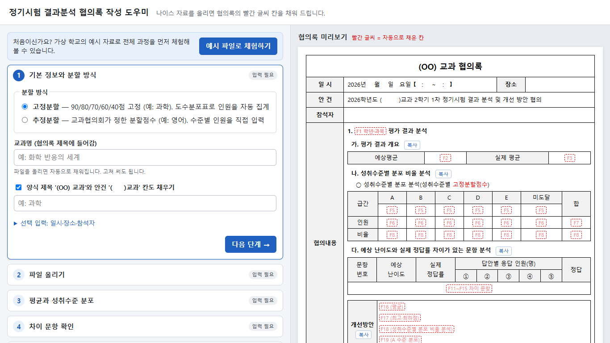
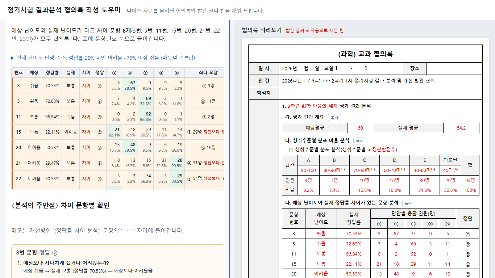

# 정기시험 결과분석 협의록 작성 도우미

나이스에서 내려받은 정기시험 자료 4종을 올리면, 「정기시험 결과분석 협의록」 양식의 **빨간 글씨 칸**(평균, 성취수준별 인원·비율, 예상 난이도와 정답률이 다른 문항, 개선방안 초안)을 자동으로 채워 줍니다.
인원 세기, 비율 계산, 문항별 응답 인원 옮겨 적기를 손으로 하지 않아도 되고, 개선방안은 수치를 반영한 초안을 고쳐 쓰기만 하면 됩니다.
설치 없이 브라우저(크롬·엣지)에서 바로 쓰며, **올린 파일은 이 컴퓨터 밖으로 나가지 않습니다.**

**바로 쓰기:** https://haedalt.github.io/hyeobuirok-helper/





> 처음이라면 첫 화면의 **[예시 파일로 체험하기]** 를 눌러 보세요. 가상 학교(한빛고등학교)의 가상 자료로 전체 과정을 해 볼 수 있습니다.
> 예시 파일은 [`public/demo/`](public/demo/)에 있어 내려받아 직접 끌어다 놓아 볼 수도 있습니다.

---

## 사용 방법

### 1. 나이스에서 파일 내려받기

**4종 모두 엑셀로 내려받는 것을 권장합니다.** 나이스에서 형식을 고를 수 있습니다(문항정보표·성적집계표는 PDF로 받아도 읽습니다). 파일 이름은 'download-숫자'여도 괜찮습니다. 앱이 내용을 보고 종류를 알아서 나눕니다.

| 파일 | 형식 | 나이스 메뉴 경로 | 협의록에서 쓰는 값 | 필요 |
| --- | --- | --- | --- | --- |
| 문항분석표 | 엑셀 | 평가 › 정기시험조회/통계 › 정기시험통계 › 문항분석표 | 실제 정답률, 답안별 응답 인원 | 필수 |
| 문항정보표 | 엑셀 (PDF도 가능) | 평가 › 정기시험 › 문항정보표관리 › 조회 | 예상 난이도 | 필수 |
| 성적집계표 | 엑셀 (PDF도 가능) | 평가 › 정기시험조회/통계 › 정기시험통계 › 성적집계표 | 실제 평균, 최고·최하점 | 필수 |
| 도수분포표 | 엑셀 | 정기시험 도수분포표 | 성취수준별 인원 | 고정분할만 |

- 문항분석표는 **한 반(강의실) 파일 하나만** 있으면 됩니다. 괄호 안의 학년 전체 값을 씁니다.
- 문항정보표를 읽지 못하면(스캔한 PDF 등) 2단계에서 '예상 난이도를 직접 입력하겠습니다'를 고르고 4단계에서 문항별로 고르면 됩니다.

### 2. 고정분할과 추정분할

| | 고정분할 (예: 과학) | 추정분할 (예: 영어) |
| --- | --- | --- |
| 분할점수 | 90 / 80 / 70 / 60 / 40점 고정 | 교과협의회가 정한 점수 5개 |
| 성취수준별 인원 | 도수분포표에서 **자동 집계** | 교사가 **직접 입력** (6칸) |
| 필요한 파일 | 공통 3종 + 도수분포표 | 공통 3종 |

추정분할점수는 10점 급간 중간에 걸리기 때문에 도수분포표로는 인원을 셀 수 없어 직접 입력을 받습니다. 교과별로 마지막에 고른 분할 방식과 분할점수는 이 브라우저에 기억해 두었다가 다음 시험에 기본값으로 보여 줍니다.

### 3. 다섯 단계

1. **기본 정보** — 분할 방식, 교과명(파일에서 자동으로 읽음, 고쳐 쓸 수 있음), 필요하면 일시·장소·참석자
2. **파일 올리기** — 여러 파일을 한꺼번에 끌어다 놓기. 읽은 내용 요약과 파일끼리 맞지 않는 곳(다른 과목 파일, 응시자 수 불일치 등)을 알려 줍니다.
3. **평균과 성취수준** — 예상평균 입력. 추정분할이면 분할점수와 수준별 인원 입력
4. **차이 문항 확인** — 예상 난이도 ≠ 실제 난이도(정답률 25% 미만 어려움, 75% 이상 쉬움)인 문항이 모두 협의록에 들어갑니다. 문항마다 〈분석의 주안점〉 질문에 데이터로 답할 수 있는 부분은 미리 채워 두고, 오개념·오답 이유는 메모로 적습니다.
5. **개선방안과 내보내기** — 수치에 맞춰 고른 문장 초안 5개를 고쳐 쓰고 내려받습니다. `~~~` 는 직접 채울 자리입니다.

오른쪽 미리보기는 협의록 양식과 같은 순서·표 구성이고, 자동으로 채운 값은 양식처럼 빨간 글씨로 보입니다.

### 4. 협의록 내보내기

5단계에서 세 가지 방법 중 편한 것을 쓰면 됩니다.

| 방법 | 쓰는 법 | 이럴 때 |
| --- | --- | --- |
| **HWPX 내려받기** | 5단계 [HWPX 내려받기] | 협의록 파일을 통째로 받을 때 |
| **표 복사** | 미리보기 각 표 위 [복사] → 한/글 양식의 해당 위치에 붙여넣기(Ctrl+V) | 학교에서 쓰던 HWP 양식에 표만 옮길 때 |
| **PDF 인쇄** | 5단계 [PDF로 인쇄] → 인쇄 창에서 'PDF로 저장' | 결재·보관용 |

**HWPX 파일 여는 법**
- 내려받은 `2026학년도_2학기_1차_정기시험_결과분석_협의록_교과명.hwpx` 파일을 **한/글 2014 이상**에서 엽니다(파일을 두 번 누르거나, 한/글의 파일 › 불러오기).
- HWP 파일이 필요하면 한/글에서 **파일 › 다른 이름으로 저장 › 파일 형식: 한/글 문서(*.hwp)** 로 저장합니다.
- 채운 칸은 양식처럼 빨간 글씨입니다. 결재용으로 검정 글씨가 필요하면 내려받기 전에 '채운 글씨를 검정으로 바꾸기'를 켜세요.
- 고정분할이면 고정분할 표만, 추정분할이면 추정분할 표와 분할점수 문장만 남고 '혹은' 문단은 지워집니다. '다.' 표는 차이 문항 수만큼 행이 늘어납니다.
- '일시' 칸과 안건의 '2학기 1차 정기시험'은 양식에 적힌 그대로이니 필요하면 한/글에서 고쳐 주세요.

---

## 개인정보

- 엑셀·PDF를 읽고 계산하는 일은 **모두 브라우저 안에서** 합니다. 파일과 성적은 어떤 서버로도 보내지 않고 저장하지도 않습니다.
- 브라우저에 저장하는 것은 교과별 분할 방식·분할점수·난이도 기준값뿐입니다. 4단계 메모는 저장하지 않아 새로고침하면 사라집니다.
- 학교 컴퓨터를 함께 쓴다면 작업 후 브라우저 탭을 닫아 주세요.

## 알려진 한계

- **서답형(논술형) 문항은 분석하지 않습니다.** 문항분석표에 객관식(OMR) 문항만 있기 때문입니다. 서답형 배점이 있으면 안내만 합니다.
- **A~C 3단계(+미도달) 과목은 아직 지원하지 않습니다.** (진로선택·융합선택 등) 양식 표가 4칸이라 별도 템플릿이 필요합니다.
- 고정분할 경계는 90/80/70/60/**40**점으로 고정되어 있습니다. E/미도달 경계가 다른 교과는 추정분할로 입력해 주세요.
- 개선방안 'A 학생 분포' 문장은 도수분포표의 **강의실** 기준입니다. 성적집계표의 학반 단위와 다를 수 있습니다.
- 답지별 백분율 행(매뉴얼 표에만 있음)은 화면에는 보이지만 협의록에는 넣지 않습니다.
- 추정분할 교과의 수준별 인원은 직접 입력해야 합니다. ('학업성취율 현황' 파일 업로드는 검토 중)
- 크롬·엣지 최신 버전 기준으로 만들었습니다. 1366×768 화면에서 스크롤 없이 단계를 진행할 수 있습니다.
- 나이스 출력 양식이 바뀌면 파일을 읽지 못할 수 있습니다. 이때는 어느 칸을 못 읽었는지 안내합니다.

---

## 개발자용

작업 규칙은 [`CLAUDE.md`](CLAUDE.md)에 있습니다. 요구사항 문서(PRD)와 실제 학교 자료로 만든 테스트는 실제 시험 수치가 들어 있어 저장소에 올리지 않고 개발자 컴퓨터에만 둡니다(`docs/PRD.md`, `samples/`, `tests/local/`).

```bash
npm install
npm run dev      # 개발 서버
npm test         # Vitest. 공개 테스트는 public/demo/ 가상 파일로 돈다 (tests/local/이 있으면 함께 실행)
npm run build    # 타입 검사 + 빌드 → dist/ (base 경로 = /저장소 이름/)
npm run lint     # oxlint
npm run e2e      # 빌드 후 '예시 파일로 체험하기'로 브라우저 전체 과정 확인 (설치된 Microsoft Edge 사용)
node scripts/e2e-demo.mjs https://<사용자>.github.io/<저장소>/   # 배포된 주소에서 같은 확인
```

기술 스택: Vite + React + TypeScript, Vitest, SheetJS(엑셀, `vendor/`에 공식 배포판), pdfjs-dist(PDF 글자 좌표로 표 복원, PDF를 올렸을 때만 불러옴), JSZip·@xmldom/xmldom(HWPX).

| 경로 | 내용 |
| --- | --- |
| `src/parsers/` | 엑셀·PDF → 데이터. 셀 좌표 대신 머리글 글자로 위치를 찾는다 |
| `src/core/` | 계산·판정 (UI와 무관한 순수 함수). F1~F20 타입은 `types.ts` |
| `src/core/narrative.ts` | **개선방안 문장 틀과 기준값** (평균 차이 5점, A 수준 쏠림 50% 등). 문장을 고치려면 이 파일 상단의 `TEMPLATES`와 상수를 고치면 된다 |
| `src/core/constants.ts` | 고정분할 경계, 난이도 판정 기준(25%/75%) |
| `src/ui/` | 화면. 상태는 `useMinutesState.ts`, 미리보기는 `components/Preview.tsx` |
| `src/export/` | 내보내기. `hwpx.ts`는 `templates/협의록_양식.hwpx`의 표시어(PRD 4-1)를 값으로 바꿔 HWPX를 만든다(브라우저·Node 공용). `clipboard.ts`는 표 복사 |
| `public/demo/` | 공개용 가상 예시 파일(엑셀 4종). `node scripts/make-demo.mjs <한글 TTF 글꼴>`로 다시 만든다 (나눔고딕 OFL 권장). 같은 데이터의 PDF판은 `tests/fixtures/demo-pdf/`, 정답값은 `tests/fixtures/demo-expected.json` |
| `scripts/` | 데모 생성, 브라우저 검사, PDF 좌표 덤프(`pdf-dump.mjs`) |
| `vendor/` | SheetJS 공식 배포판(`xlsx-0.20.3.tgz`, Apache-2.0). 설치 때 외부 CDN에 기대지 않도록 저장소에 둔다 |
| `templates/` | 협의록 양식. `협의록_양식.hwpx`(표시어 57개 + 선택 4개)가 내보내기 템플릿 |
| `samples/`, `tests/local/`, `docs/PRD.md` | 실제 학교 자료와 그 기대값. **저장소에 올리지 않는다** (`.gitignore`) |

`main`에 푸시하면 GitHub Actions가 린트 → 테스트 → 빌드 → GitHub Pages 배포를 합니다(`.github/workflows/deploy.yml`).

## 라이선스

[MIT](LICENSE). 자유롭게 쓰고 고치고 나눌 수 있습니다.

`public/demo/`의 예시 PDF에는 [나눔고딕](https://github.com/google/fonts/tree/main/ofl/nanumgothic)(SIL Open Font License 1.1)의 일부 글자가 들어 있습니다. 예시 파일의 학교·교사·과목·성적은 모두 가상입니다.
